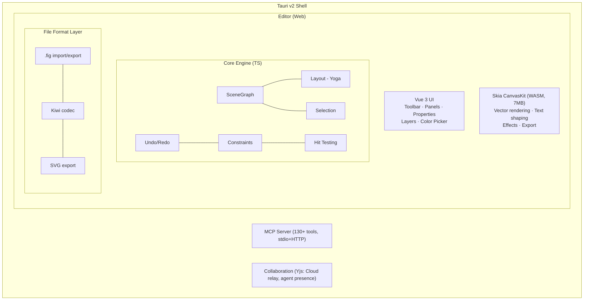

# Architecture

## System Overview

For source identity, override evaluation, page sessions, and export contracts, see
[.fig Reader Architecture](./fig-reader).

## Editor Layout

The editor opens on the canvas alone, laid out as pen.dev's, with one top bar above it for the menus, document tabs, and the open document's actions:

- **Toolbar (canvas left)** — Tool selection: Select, Frame, Section, Rectangle, Ellipse, Line, Text, Pen, Hand, and the others the editor profile offers, with the layers panel's toggle above them
- **Canvas (center)** — Infinite canvas with CanvasKit rendering, zoom/pan; the zoom sits in its bottom right corner and a prompt at its bottom sends what you write to the AI chat
- **Sidebar (left)** — Tabs for the layers tree and pages, assets, slides, and the Design view: the context-sensitive properties sections such as Appearance, Fill, Stroke, Typography, Layout, Position, and Prototype. It opens from its toggle and never from a selection; the Design view follows the selection once it is showing
- **AI chat (right column)** — A resizable column beside the canvas, opened with ⌘J or the top bar

## Components

### Rendering (CanvasKit WASM)

The same rendering engine as Figma. CanvasKit provides GPU-accelerated 2D drawing with vector shapes, text shaping via Paragraph API, effects (shadows, blurs, blend modes), and export (PNG, SVG). The 7MB WASM binary loads at startup and creates a GPU surface on the HTML canvas.

The renderer is split into focused modules in `packages/core/src/renderer/`: scene traversal, overlays, fills, strokes, shapes, effects, rulers, labels, and remote cursors.

### Scene Graph

Flat `Map<string, Node>` keyed by GUID strings. Tree structure via `parentIndex` references. Provides O(1) lookup, efficient traversal, hit testing, and rectangular area queries for marquee selection.

The graph emits typed events via nanoevents: `node:created`, `node:updated`, `node:deleted`, `node:reparented`, `node:reordered`. Subsystems subscribe to these instead of manual call-site wiring — the editor uses them for render invalidation and microtask-batched component instance sync, while the collab system uses them for Yjs propagation.

See [Scene Graph Reference](/reference/scene-graph) for internals.

### Variable expressions

Scene Graph owns the canonical variable definitions: literals, stable-ID aliases, bounded formula trees that give numbers, Booleans, text or colors, and composed colors. Shared Valibot schemas validate expression structure on FIG import, FIG export, and resolution. The resolver owns mode selection, dependency traversal, cycles, and evaluation; draft validation supplies an override without mutating the document. Canvas callers treat resolution failures as unresolved values, while the inspector retains diagnostics. Core applies edits, undo, binding reconciliation, and layout.

Formula trees name operators in Pairdraw's own terms (`add`, `truthy`, `if`) with Figma's operand signatures and value rules: `+` joins text, `text()`, `truthy()` and `if()` convert and choose as Figma's `STRINGIFY`, `IS_TRUTHY` and `TERNARY` do, and number text follows Figma's two-decimal format. The FIG package alone maps each operator to Figma's `ExpressionFunction`, so other formats read and write the same tree. An expression the reader cannot hold as a formula, such as one naming a variable the file lacks, is kept as the file wrote it. Scene Graph parses formula text into a tree, checking operand types as it goes, and prints a tree back with only the parentheses precedence needs; references are `{name}` in text and IDs in the tree. Editors show references as pills and never ask users to type braces.

A formula in `valuesByMode` is live document behavior. `expressions[modeId].css` is separate, target-specific CSS that replaces the value in CSS alone, edited in its own field. The token stylesheet writes number formulas as `calc()` over `var()` references, checking that units add and multiply as CSS allows, and declares a formula again in each mode scope that changes a variable it uses. Design-token files hold each mode's result with the formula in `$extensions`. Design JSX preserves node bindings through `designVar`, but does not yet bundle the referenced formula definitions; formulas that give Booleans, text or colors, or use `if()`, have no CSS form.

### Layout Engine (Yoga WASM)

Yoga supplies CSS flexbox and grid layout computation, through a fork with CSS Grid support. A thin adapter maps Figma property names to Yoga equivalents:

| Figma Property          | Yoga Equivalent         |
| ----------------------- | ----------------------- |
| `stackMode: HORIZONTAL` | `flexDirection: row`    |
| `stackMode: VERTICAL`   | `flexDirection: column` |
| `stackSpacing`          | `gap`                   |
| `stackPadding`          | `padding`               |
| `stackJustify`          | `justifyContent`        |
| `stackChildPrimaryGrow` | `flexGrow`              |

### File Format (Kiwi Binary)

Reuses Figma's Kiwi binary codec, whose schema holds 605 message, enum and struct definitions. Import: parse header → Zstd decompress → Kiwi decode → `NodeChange`[] → scene graph. Export reverses the process with thumbnail generation.

See [File Format Reference](/reference/file-format) for details.

### AI & Tools

Tools are defined once in `packages/core/src/tools/`, split by domain: read, create, modify, structure, variables, vector, analyze. Each tool has typed params and an `execute(figma, args)` function. Adapters convert them for:

- **AI chat** — valibot schemas, multi-provider (Anthropic, OpenAI, Google AI, OpenRouter, compatible endpoints)
- **MCP server** — zod schemas, stdio + HTTP transports
- **CLI** — available via the `eval` command, whose scripts get the `figma` Plugin API and the `pairdraw` API

More than 130 core tools, plus MCP file management tools. Includes XPath query (`query_nodes`), JSX inspection (`get_jsx`, `diff_jsx`), semantic description (`describe`), and vision-based verification (`export_image` returns images to the model).

### Behaviours and Preview

A behaviour stored on a main component makes it work as a Reka UI control. Preview runs top-level layers holding controls as live islands: shadow-DOM projections laid over the canvas, with each control mounted as its Reka UI primitive and drawn by the component's variants. See [Behaviours and Preview](./behaviours-and-preview).

### Undo/Redo

Inverse-command pattern. Before applying any change, affected fields are snapshotted. The snapshot becomes the inverse operation. Batching groups rapid changes (like drag) into single undo entries.

### Clipboard

Figma-compatible bidirectional clipboard. Encodes/decodes Kiwi binary (same format as .fig files) via native browser copy/paste events. Handles vector path scaling, instance children, component set detection, and override application.

### Collaboration

Yjs CRDT documents with the awareness protocol for live cursors, selections, and presence. Cloud documents sync through their server's relay ([Cloud Architecture](./cloud#live-collaboration)), and AI agents publish their cursors through the same presence layer. Peer-to-peer rooms over Trystero (WebRTC, signaling over MQTT public brokers, local persistence via y-indexeddb) stay in the code but are off in Pairdraw builds (`COLLABORATION_INCLUDED` in `src/constants.ts`).

### CLI-to-App RPC Bridge

When the app is running, CLI commands given no file send RPC requests (`POST /rpc`) to its MCP server instead of reading a document. The CLI finds the server through its discovery file and prefers a private Unix domain socket on macOS and Linux, falling back to `127.0.0.1:7600`; the app is connected to that server over WebSocket. Commands execute against the live editor state, enabling automation scripts and AI agents to interact with the running app.

## What's Next

### Full Tool Set

The MCP server exposes 142 tools. The gaps left against [figma-use](https://github.com/dannote/figma-use), a Figma MCP server kept as a reference, cover advanced layout constraints, prototype connections, advanced component property editing, and bulk document operations.

### CI Design Tooling

The headless CLI already supports `analyze colors/typography/spacing/clusters`. Next: GitHub Actions integration for automated design linting and visual regression in PRs.

### Prototyping

Preview already runs components with behaviours as live controls, and the Prototype section plays click and after-delay interactions that navigate between frames, open and close overlays, or go back, with instant, dissolve, or Smart animate transitions, stored as Figma prototype reactions. Next: variables that let controls drive the rest of a design, and more triggers and transitions.

### Code Signing

Pairdraw 0.18.0 is published for macOS on Apple Silicon only, and that build is not signed or notarized. Next: a signed and notarized macOS build, and Windows releases with Authenticode signing to remove the SmartScreen warning.
